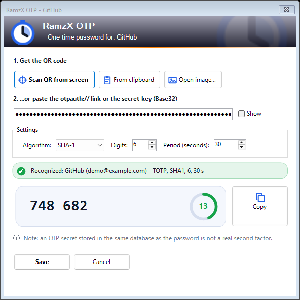
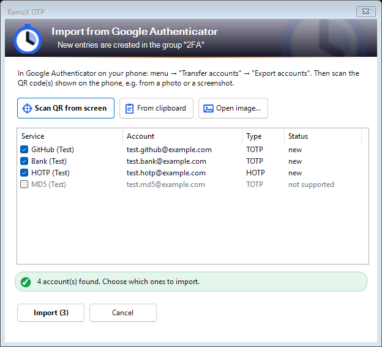
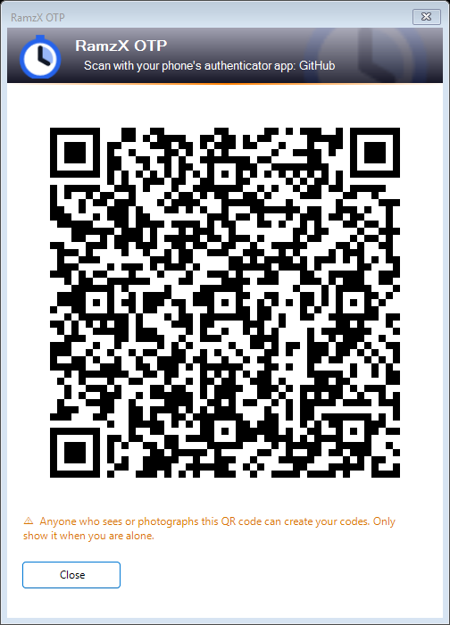

<div align="center">

# RamzX OTP

### One-time passwords (TOTP / HOTP / Steam Guard) for KeePass 2 – scan the QR code straight from your screen

**English** · [Deutsch](translations/README.de.md) · [العربية](translations/README.ar.md)

[](https://github.com/RamzXHQ/RamzX-OTP/actions/workflows/build.yml)
[](LICENSE)


Free and open source · Made in Germany by **[RamzX](https://ramzx.de)**

</div>

---

**RamzX OTP** is a free, open-source plugin for **KeePass 2** that adds **two-factor
authentication codes** (TOTP and HOTP, as used by Google Authenticator, Microsoft
Authenticator and most websites) to your KeePass entries. Click the QR code shown by a
website and the plugin reads it directly from your screen – no phone, no typing.

> **Status: alpha.** Please keep a backup of your database while testing.

## Features

| | |
|---|---|
| 📷 **Scan QR codes from the screen** | Click the QR code on any monitor; also from the clipboard, an image file or a pasted `otpauth://` link |
| 📲 **Import from Google Authenticator** | Reads the *Transfer accounts* export QR codes (also several at once) and creates one entry per account |
| 🔁 **Convert old plugin formats** | KeeOtp, KeeTrayTOTP, KeePassOTP and KeePassXC `otp` fields → KeePass's own OTP fields, in one step (old values stay in the entry history) |
| ⏱️ **Live code column** | Optional column in the entry list with the current code and the seconds left; click to copy |
| 📋 **Copy from the context menu** | *Copy OTP code 123 456 (20 s)* right below *Copy Password*; KeePass clears the clipboard automatically |
| 📱 **Show as QR code** | Move an account to your phone's authenticator app |
| 🎮 **Steam Guard** | 5-character Steam codes |
| 🔐 **Windows Hello before copying** *(optional)* | Together with [RamzX Unlock](https://github.com/RamzXHQ/RamzX-Unlock): Windows Hello before a code is copied or shown |
| 🧷 **No lock-in** | Codes are stored in KeePass's own OTP fields (`TimeOtp-*` / `HmacOtp-*`), so KeePass's own *Ctrl+T* and `{TIMEOTP}` keep working without this plugin. Only what those fields cannot hold (Steam, more than 8 digits) goes into the `otp` field as an `otpauth://` link, the format KeePassXC uses |
| 🌍 **English, German, Arabic** | The language follows KeePass, otherwise Windows |
| 🚫 **No network, no telemetry** | 100 % own code, no third-party libraries – also the QR code reader and writer |

## Screenshots

| Add a one-time password | Import from Google Authenticator | Show as QR code |
|---|---|---|
|  |  |  |

*Screenshots show test data only.*

## Install

1. Close KeePass.
2. Download `RamzXOtp.dll` from [Releases](https://github.com/RamzXHQ/RamzX-OTP/releases) and check the
   SHA-256 against `SHA256SUMS.txt`.
3. Copy it into the `Plugins` folder of KeePass 2.60+ and start KeePass.

**Usage:** right-click an entry → *RamzX OTP* → *Add or replace…* → *Scan QR from screen* → click the
QR code. To show the live column: *View → Configure Columns → RamzX OTP*.

> **Windows 11 Smart App Control** blocks DLLs that are not code-signed. Our releases are not
> signed yet; on PCs with Smart App Control turned on, the plugin cannot be loaded.

## Security – honestly

- **Same database = not a real second factor.** Storing the OTP secret next to the password is
  convenient, but whoever gets your database and master password gets both. For your most
  important accounts, consider a separate database or a separate authenticator.
- **Windows Hello** (with RamzX Unlock) always accepts the Windows Hello PIN – it is a convenience
  protection, not a second factor. KeePass's own *Ctrl+T* and the entry editor are not affected by it.
- **Untrusted input is handled carefully:** QR codes, images and shared databases are checked
  (size limits, no KeePass placeholders such as `{CMD:…}` taken over from imported names), and
  every parser is tested with tens of thousands of random and damaged inputs in CI.
- Report vulnerabilities privately: **support@ramzx.de**

## Privacy (GDPR / DSGVO)

No network access, no accounts, no telemetry. Screen pixels are only read after your click,
kept in memory and never saved. Everything stays in your KeePass database.

## Build from source

```
dotnet build src/RamzXOtp/RamzXOtp.csproj -c Release -p:KeePassDir=<folder with KeePass.exe>
```

Tests: `dotnet test tests/RamzXOtp.Tests` (RFC 4226/6238 test vectors, QR codes, formats, fuzzing).

## Research behind the design

[Analysis of existing KeePass OTP plugins, user complaints, formats and QR scanning](docs/research/report-keepass-otp-plugins.md).
RamzX OTP is written from scratch; no code was copied from other projects.

## About RamzX

RamzX OTP is developed and maintained by **[RamzX](https://ramzx.de)**, Germany.
Questions, feedback or business inquiries: **support@ramzx.de**

⭐ If RamzX OTP is useful to you, please star the repository – it helps others find it.

## License

MIT – see [LICENSE](LICENSE). © 2026 RamzX.
KeePass is a project by Dominik Reichl. RamzX OTP is an independent plugin and not affiliated with
the KeePass project. Google Authenticator and Steam are trademarks of their respective owners.

<sub>Keywords: KeePass OTP plugin, KeePass TOTP, KeePass 2FA, KeePass two-factor authentication,
KeePass QR code, KeePass Google Authenticator import, KeePass Steam Guard, KeeOtp alternative,
KeeTrayTOTP alternative, KeePass Einmalpasswort, KeePass Zwei-Faktor, KeePass رمز التحقق.</sub>
